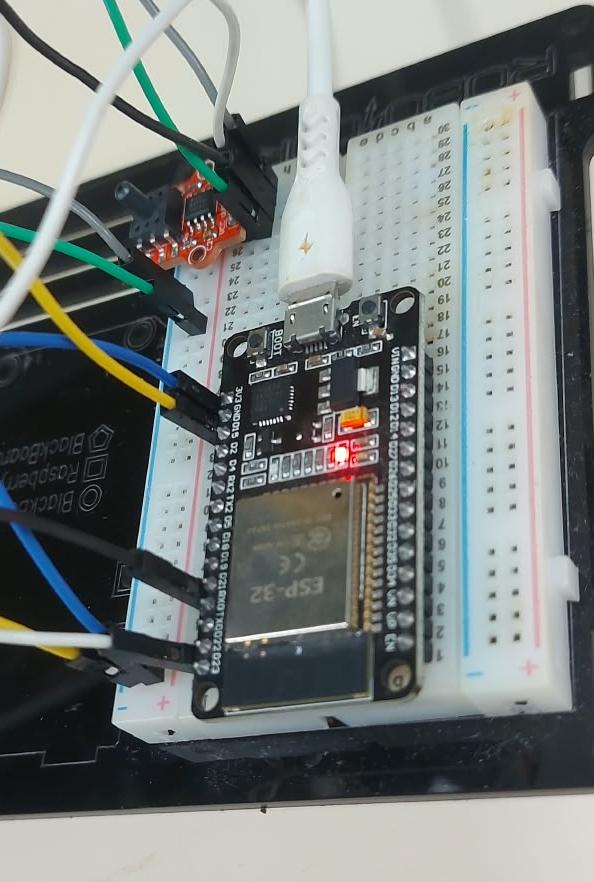

# Monitor de Umidade e Pressão do Solo via IoT

Sistema de monitoramento em tempo real da tensão matricial e umidade do solo. O projeto utiliza um tensiômetro analógico adaptado com um sensor de pressão **HX710B** e um microcontrolador **ESP32**, integrado a uma API REST em **Python (FastAPI)** que processa os dados e os armazena em nuvem utilizando o **MongoDB Atlas**.

---

## Visualização do Hardware (Protótipo)

Abaixo é apresentado o circuito com o ESP32 e o módulo HX710B em bancada:
<p align="center">
  
</p>

## Arquitetura da Solução

Arquitetura do fluxo de dados:

ESP32 + HX710B (Sensor) ──> HTTP POST (JSON) ──> API REST (FastAPI) ──> PyMongo ──> MongoDB Atlas (Nuvem)

1. **Camada de Hardware (Firmware C++):** O ESP32 realiza a leitura do módulo HX710B, converte o valor bruto para unidades de pressão reais (kPa) e transmite as informações via Wi-Fi usando requisições HTTP POST.
2. **Camada de Backend (API Python):** Desenvolvida com **FastAPI**, a aplicação recebe o payload JSON, valida os dados utilizando o **Pydantic**, aplica regras de negócio para categorizar a umidade do solo e gerencia a conexão com o banco de dados.
3. **Camada de Persistência (Banco de NoSQL):** Os registros são armazenados de forma estruturada na nuvem do **MongoDB Atlas**.

---

## Tecnologias Utilizadas

* **Hardware & Embarcados:** ESP32, Módulo Conversor ADC HX710B (24-bit), Tensiômetro com cápsula porosa.
* **Backend & API:** Python 3.12+, FastAPI, Uvicorn, Pydantic, PyMongo, Python-Dotenv.
* **Banco de Dados:** MongoDB Atlas (NoSQL Cloud Database).
* **Firmware:** C++ (Arduino IDE / ArduinoJson / Biblioteca HX710AB).

---

## Estrutura do Repositório

```text
api-tensiometro-iot/
├── firmware/
│   └── tensiometro_esp32.ino    # Código fonte C++ para gravação no ESP32
├── main.py                      # Servidor da API em Python (FastAPI)
├── .env.example                 # Template de variáveis de ambiente
├── .gitignore                   # Arquivos ignorados pelo controle de versão
├── requirements.txt             # Dependências e bibliotecas do projeto Python
└── README.md                    # Documentação principal do projeto
```
---

## Como Executar o Projeto Localmente

Pré-requisitos:
 - Python 3.12+ instalado na sua máquina.

 - Uma conta ativa e um Cluster criado no MongoDB Atlas.

 - Arduino IDE (caso deseje carregar o firmware no ESP32).

1. Clonar o Repositório
git clone [https://github.com/Brenopy/api-tensiometro-iot.git]
cd api-tensiometro-iot

2. Configurar o Ambiente Virtual Python
# Criar a venv
python -m venv venv

# Ativar o ambiente virtual
# No Windows (PowerShell):
venv\Scripts\activate
# No Linux/Mac:
source venv/bin/activate

3. Instalar as Dependências
pip install -r requirements.txt

4. Configurar as Variáveis de Ambiente
 ** Duplique o arquivo .env.example e renomeie a cópia para .env
 ** Preencha com as suas credenciais de acesso do MongoDB Atlas (instruções também no arquivo .env.example)

5. Iniciar a API localmente
uvicorn main:app --reload --host 0.0.0.0 --port 8000
A documentação interativa da API (Swagger UI) estará disponível em: http://127.0.0.1:8000/docs

## Configuração e Uso do Hardware (ESP32)

1. Abra o arquivo localizado em firmware/tensiometro_esp32.ino utilizando a Arduino IDE.

2. Instale as bibliotecas necessárias pelo gerenciador da IDE: ArduinoJson e HX710AB.

3. Altere as credenciais do seu Wi-Fi e o endereço IP da máquina onde a API está rodando:

```cpp
const char* ssid = "NOME_DO_SEU_WIFI";
const char* password = "SENHA_DO_WIFI";
const char* serverUrl = "http://<IP_DO_SEU_PC>:8000/api/leituras";
```

4. Conecte o ESP32 ao computador, selecione a placa correta (ESP32 Dev Module) e faça o upload (Carregar) do código.

## Regras de Negócio (Classificação do Solo)

A API avalia automaticamente a pressão métrica lida pelo tensiômetro em quilopascals ($\text{kPa}$):
- **$\le 10\text{ kPa}$**: `Solo Úmido` (Saturado / Evitar irrigação excessiva).
- **Entre $10\text{ kPa}$ e $30\text{ kPa}$**: `Umidade Ideal` (Condição favorável para o desenvolvimento radicular).
- **$> 30\text{ kPa}$**: `Solo Seco / Irrigar` (Alta tensão de retenção de água, necessidade de acionamento do sistema de irrigação).